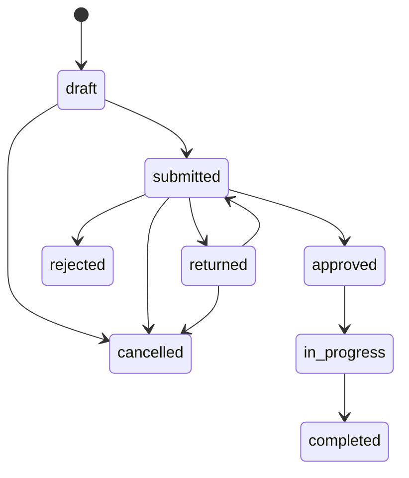

# Service Requests Manager

Service Requests Manager is a Laravel API and Next.js application for submitting, approving, assigning, and completing internal service requests. Employees create requests, managers review them, and operations users fulfill approved work. The backend is the source of truth for authorization, workflow state, audit history, and notifications.

## Workflow



## Stack

- Laravel Framework 12.72.0
- PHP 8.5 or newer
- PostgreSQL 14 or newer, PostgreSQL 16 recommended
- Laravel Sanctum 4 for bearer-token authentication
- Pest 4, Laravel Pint 1, and Larastan 3
- Next.js 16.4.6 with App Router and TypeScript
- React 19 and TanStack Query 5
- Tailwind CSS 4
- Vitest 3 and React Testing Library

## Quick start

### Requirements

- PHP 8.5 or newer with `pdo_pgsql`, `mbstring`, `xml`, `curl`, `zip`, and `bcmath`
- Composer 2
- PostgreSQL running locally
- Node.js 20 or newer and npm

On Windows, Laragon can manage PHP and PostgreSQL. Select PHP 8.5 in Laragon, close existing terminals, and open a new terminal. Verify that `php -v` reports PHP 8.5 or newer before running Composer or Artisan.

### Backend

Create the `service_requests` PostgreSQL database and make sure the password in `backend/.env` matches the local `postgres` user.

```powershell
cd backend
Copy-Item .env.example .env
composer install
php artisan key:generate
php artisan migrate:fresh --seed
php artisan serve --port=5000
```

With the direct PHP fallback:

```powershell
& $php $composer install
& $php artisan key:generate
& $php artisan migrate:fresh --seed
& $php artisan serve --port=5000
```

Run the queue worker in a second terminal to process notification jobs:

```powershell
php artisan queue:work
```

Keep this worker running while developing. Status-change and workflow notifications
are queued in PostgreSQL and will not appear in the notification bell until the
worker processes them.

### Frontend

```powershell
cd frontend
Copy-Item .env.example .env.local
npm install
npm run dev
```

The frontend development server runs on port 3000.

URLs:

- Frontend: <http://localhost:3000>
- Backend: <http://localhost:5000>
- Health check: <http://localhost:5000/api/health>
- Scalar API documentation: <http://localhost:5000/docs>
- OpenAPI specification: `backend/docs/openapi.yaml`

## Seeded logins

All demo accounts use the password `password`.

| Role       | Email                             |
| ---------- | --------------------------------- |
| Employee   | `employee1@service-requests.test` |
| Employee   | `employee2@service-requests.test` |
| Manager    | `manager@service-requests.test`   |
| Operations | `ops1@service-requests.test`      |

The demo request seeder uses the real workflow services to create requests, transitions, comments, audit logs, and notification records. After seeding, run `php artisan queue:work --stop-when-empty` to process queued demo notifications.

## Running tests

Backend commands run from `backend/`:

```powershell
composer test
composer check
```

`composer check` runs Pint validation, Larastan, and the backend test suite. Tests require the `service_requests_test` PostgreSQL database and refuse to run against any other database.

Frontend commands run from `frontend/`:

```powershell
npm run typecheck
npm run lint
npm test
npm run build
```

## API documentation

- Scalar UI: `/docs`
- OpenAPI 3 specification: [backend/docs/openapi.yaml](backend/docs/openapi.yaml)
- Postman collection: [backend/docs/postman/ServiceRequests.postman_collection.json](backend/docs/postman/ServiceRequests.postman_collection.json)
- Architecture note: [docs/ARCHITECTURE.md](docs/ARCHITECTURE.md)
- AI usage and references: [docs/AI_USAGE_AND_REFERENCES.md](docs/AI_USAGE_AND_REFERENCES.md)

After starting the backend and seeding the database, run the collection with:

```powershell
cd backend
npx newman run docs/postman/ServiceRequests.postman_collection.json
```

## API endpoints

All endpoints except health and login require a Sanctum bearer token.

| Method | Endpoint                       | Purpose                                           | Addition justification               |
| ------ | ------------------------------ | ------------------------------------------------- | ------------------------------------ |
| GET    | `/api/health`                  | Health check                                      | Operational readiness endpoint       |
| POST   | `/api/login`                   | Authenticate a user                               | Required authentication entry point  |
| POST   | `/api/logout`                  | Revoke the current token                          | Required session lifecycle operation |
| GET    | `/api/me`                      | Return the authenticated user                     | Frontend session restoration         |
| GET    | `/api/requests`                | List visible requests with filters and pagination | Core request browsing                |
| POST   | `/api/requests`                | Create a draft or submitted request               | Core request creation                |
| GET    | `/api/requests/{id}`           | View a request                                    | Core request detail view             |
| PUT    | `/api/requests/{id}`           | Update an editable request                        | Draft and returned request editing   |
| POST   | `/api/requests/{id}/submit`    | Submit or resubmit                                | Explicit workflow transition         |
| POST   | `/api/requests/{id}/cancel`    | Withdraw a request                                | Employee cancellation rule           |
| POST   | `/api/requests/{id}/decision`  | Approve, reject, or return                        | Manager decision workflow            |
| POST   | `/api/requests/{id}/assign`    | Assign or reassign operations ownership           | Operations fulfillment workflow      |
| POST   | `/api/requests/{id}/status`    | Start or complete work                            | Operations status workflow           |
| POST   | `/api/requests/{id}/comments`  | Add a discussion comment                          | Collaboration on requests            |
| GET    | `/api/requests/{id}/activity`  | Read the audit timeline                           | Workflow traceability                |
| GET    | `/api/users?role=operations`   | List operations users                             | Assignment selector                  |
| GET    | `/api/notifications`           | List notifications                                | Notification bell                    |
| POST   | `/api/notifications/read-all`  | Mark all notifications read                       | Notification management              |
| POST   | `/api/notifications/{id}/read` | Mark one notification read                        | Notification management              |

## Business rules and assumptions

### Roles

- Employees create, edit, submit, cancel, and comment on their own requests.
- Managers review requests from direct reports and can approve, reject, return, and comment.
- Operations users view approved work, assign owners, start work, complete work, and comment.
- Each user has one nullable `manager_id`.
- Only employees create requests. Managers and operations users do not create requests.

### Statuses and transitions

- `draft`: employee is still writing the request.
- `submitted`: waiting for manager review.
- `returned`: manager sent the request back with a required comment.
- `approved`: approved and waiting for operations work.
- `in_progress`: the assignee started work.
- `completed`: final successful state.
- `rejected`: final manager decision.
- `cancelled`: final employee withdrawal.

The only valid transitions are defined in `RequestStatus::allowedTransitions()`. Draft and returned requests can be submitted or cancelled. Submitted requests can be approved, rejected, returned, or cancelled. Approved requests can become in progress, and in-progress requests can become completed. Assignment is not a status transition.

### Visibility and authorization

- Employees see their own requests in every status.
- Managers see submitted-or-later requests belonging to direct reports.
- Operations users see approved, in-progress, and completed requests.
- The backend supplies request `abilities`; the frontend renders actions from those booleans and does not duplicate authorization rules.
- `403` means the user is not allowed to perform the identity or visibility operation.
- `422` means the request is visible but its current state does not allow the attempted action.

### Notifications and audit

Notifications use database and mail channels, are dispatched after successful transactions, and never notify the actor about their own action. The activity log records creation, updates, transitions, assignments, reassignments, and comments in the same transaction as the change.

### Decisions and trade-offs

- `draft`, `returned`, and `cancelled` exist because the brief requires draft editing, manager returns, and employee withdrawal.
- The request model is `ServiceRequest` to avoid conflict with Laravel's HTTP request class.
- PostgreSQL is required because filtering uses PostgreSQL `ILIKE`.
- Workflow mutations use transactions and row locks for concurrency safety.
- The frontend stores Sanctum tokens in `localStorage`, trading XSS exposure for a simple API client.
- There are no soft deletes, comment notifications, manager delegation, or multi-level approvals.
- A request has one manager relationship and one operations assignee.
- Pagination, eager loading, indexes, lazy-loading protection, and API resources are used to keep list and detail queries predictable.

## Project structure

```text
backend/
  app/
    Enums/
    Http/Controllers/Api/
    Http/Requests/
    Http/Resources/
    Models/
    Policies/
    Services/
  database/
    factories/
    seeders/
  docs/
  routes/
  tests/
frontend/
  app/
  components/
  hooks/
  lib/
  tests/
```

## Documentation

- [Backend setup and commands](backend/README.md)
- [OpenAPI specification](backend/docs/openapi.yaml)
- [Postman collection](backend/docs/postman/ServiceRequests.postman_collection.json)
