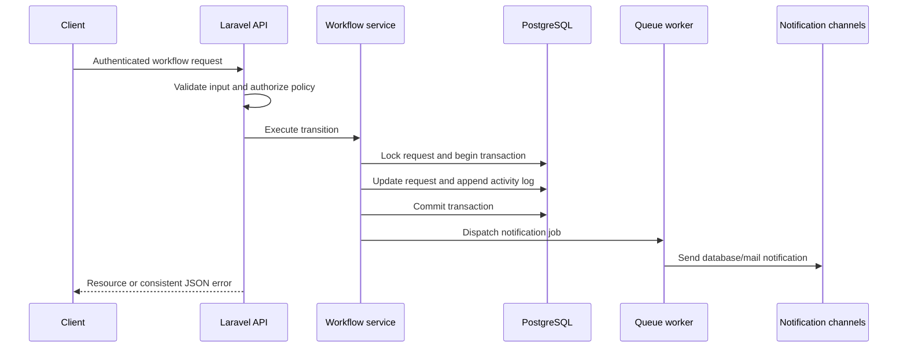

# Architecture Note

## 1. Purpose and scope

Service Requests Manager is a Laravel REST API for an internal service-request
workflow, with a Next.js client included for demonstration and manual review.
The backend is the source of truth for authentication, authorization, workflow
transitions, audit history, and notifications.

The implementation follows the assignment's three-role model:

1. **Employee** creates and tracks requests.
2. **Manager** reviews requests from direct reports.
3. **Operations user** assigns and completes approved work.

The workflow is deliberately kept in the backend so that a web or mobile client
cannot bypass business rules.

## 2. System hierarchy

```text
Client layer
├── Next.js frontend
│   ├── Authentication and route protection
│   ├── Request list, forms, details, comments, and activity timeline
│   └── Notification bell and workflow action dialogs
└── External API clients

Application layer
└── Laravel HTTP API
    ├── Controllers
    ├── Form Requests
    ├── API Resources
    ├── Policies and ability calculation
    └── Exception-to-JSON rendering

Domain layer
└── Request workflow
    ├── RequestStatus transition map
    ├── RequestWorkflowService
    ├── CommentService
    ├── ActivityLogger
    └── NotificationRecipientResolver

Persistence and asynchronous work
├── PostgreSQL
│   ├── Users and manager hierarchy
│   ├── Service requests
│   ├── Comments
│   ├── Activity logs
│   ├── Notifications
│   └── Queue jobs
└── Database queue worker
    └── SendRequestNotificationsJob
```

## 3. Request flow



Notification jobs are dispatched only after the workflow transaction succeeds.
This prevents notifications for changes that were rolled back.

## 4. Key design decisions

### Centralized workflow rules

`RequestStatus` defines the allowed status graph, while
`RequestWorkflowService` performs state changes, locking, audit logging, and
notification dispatch. Controllers remain thin and do not contain duplicated
transition logic.

See [`RequestStatus`](../backend/app/Enums/RequestStatus.php) and
[`RequestWorkflowService`](../backend/app/Services/RequestWorkflowService.php).

### Policy-first authorization

Laravel policies protect visibility and actions. Form Requests call those
policies before controllers execute. The API also returns calculated request
abilities so the frontend can render actions without becoming a second source
of authorization rules.

See [`ServiceRequestPolicy`](../backend/app/Policies/ServiceRequestPolicy.php).

### Transactional audit trail

Workflow changes, assignments, comments, and audit records are persisted
transactionally. Activity records retain the actor, event, status transition,
comment, metadata, and timestamp.

### PostgreSQL and predictable queries

PostgreSQL is the documented local database because request search uses
case-insensitive `ILIKE`. Request lists use pagination, eager loading, and
indexes for the common visibility and status queries.

### Database queue

The database queue is used locally because it works with the existing
PostgreSQL setup and requires no additional Redis service. A worker processes
`SendRequestNotificationsJob` asynchronously.

### API resources and error contract

API Resources define the response shape. API middleware forces JSON responses,
and the exception renderer maps authentication, authorization, validation,
not-found, workflow, and server failures to a consistent error structure.

## 5. Trade-offs and boundaries

- The project uses bearer tokens through Sanctum for a simple API-client
  integration. The frontend stores the token in `localStorage`; an
  httpOnly-cookie design would reduce XSS exposure for a browser-only product.
- A request has one manager relationship and one operations assignee. Multi-level
  approval, delegation, and group ownership are intentionally out of scope.
- Reassignment is supported for operational continuity, although the assignment
  only requires initial assignment.
- File attachments, SLA due dates, overdue handling, soft deletes, and comment
  notifications are not implemented because they are optional or outside the
  core brief.
- The frontend is a review client, not a second implementation of backend
  business rules.

## 6. Verification

The architecture is covered by the backend feature and unit tests under
[`backend/tests`](../backend/tests). The documented verification commands are:

```powershell
cd backend
composer test
composer check
```

The frontend has separate typecheck, lint, test, and production-build commands
documented in the [root README](../README.md).
